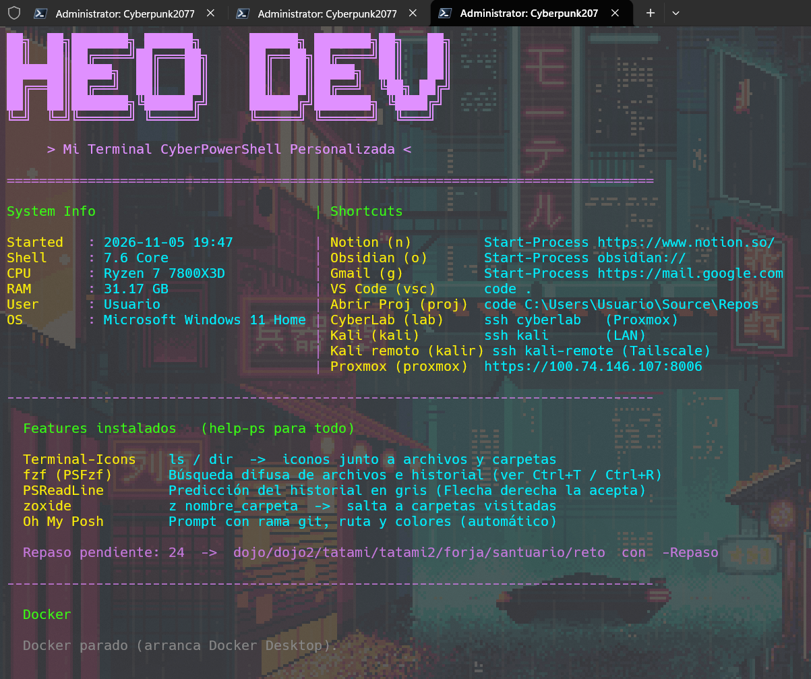
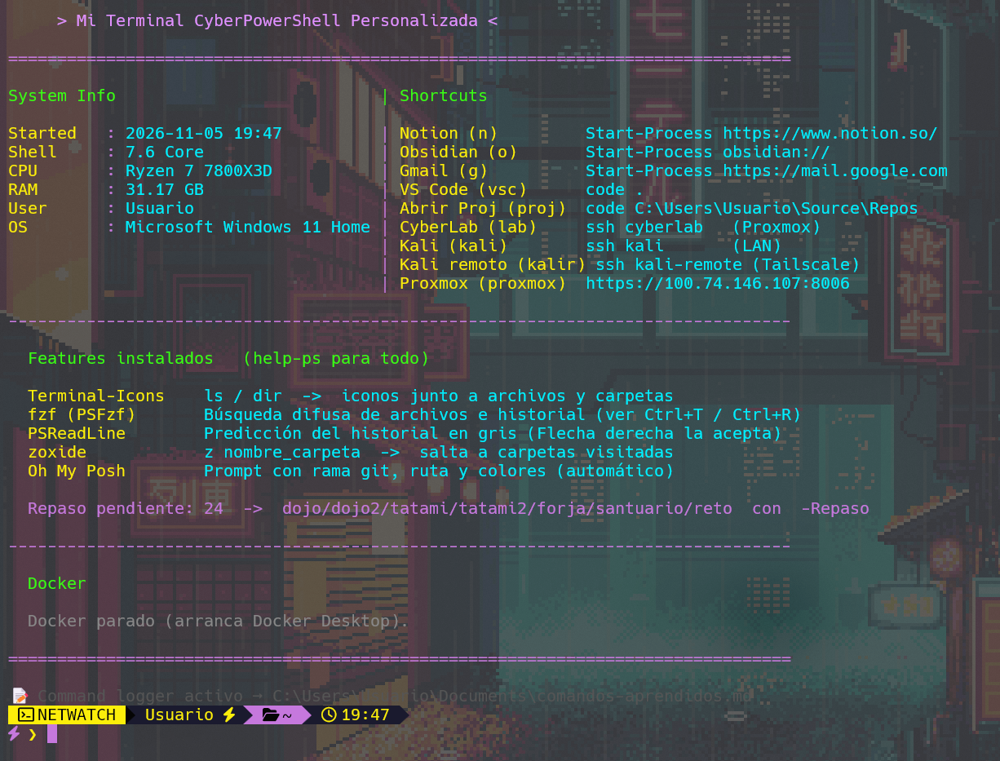
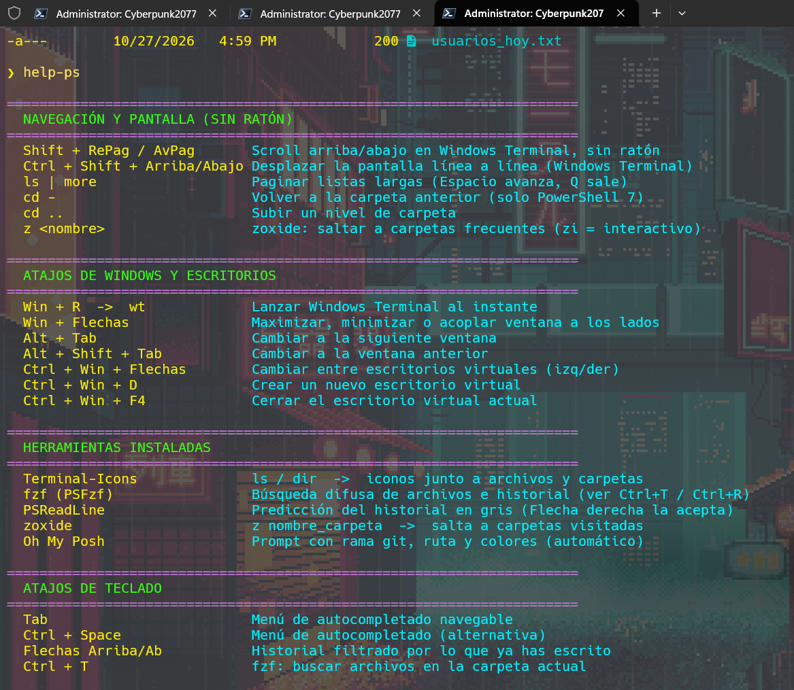
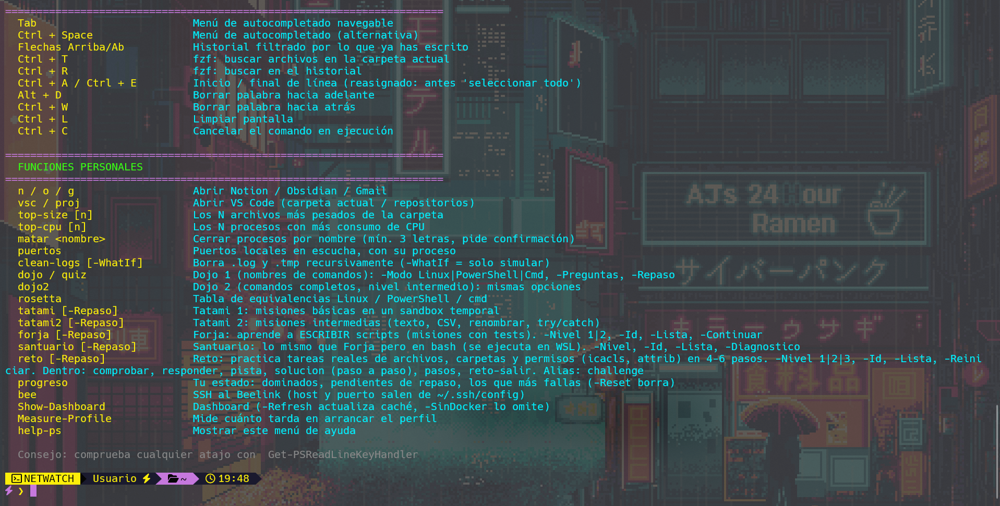
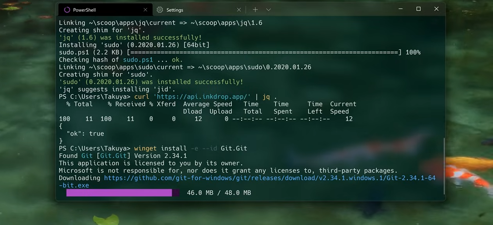
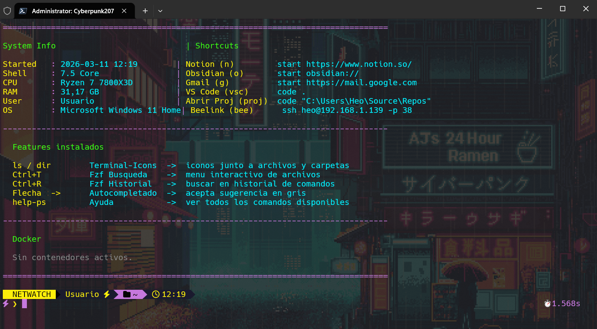
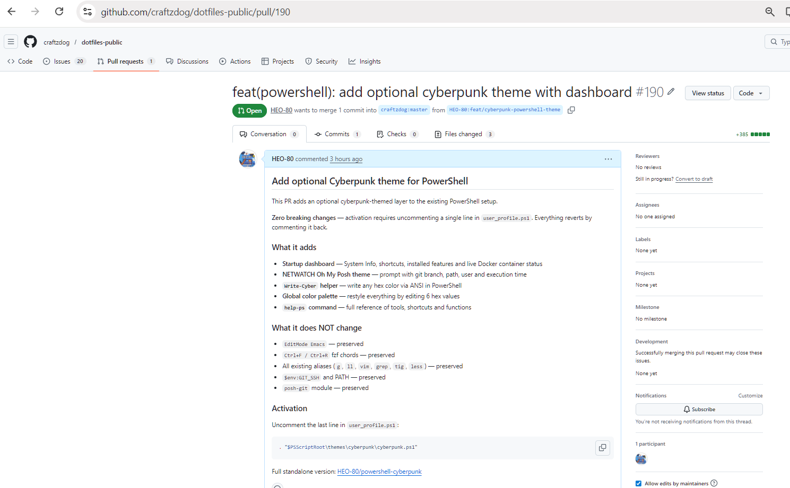

<div align="center">


<pre>
 ██╗  ██╗███████╗ ██████╗    ██████╗ ███████╗██╗   ██╗
 ██║  ██║██╔════╝██╔═══██╗   ██╔══██╗██╔════╝██║   ██║
 ███████║█████╗  ██║   ██║   ██║  ██║█████╗  ██║   ██║
 ██╔══██║██╔══╝  ██║   ██║   ██║  ██║██╔══╝  ╚██╗ ██╔╝
 ██║  ██║███████╗╚██████╔╝   ██████╔╝███████╗ ╚████╔╝
 ╚═╝  ╚═╝╚══════╝ ╚═════╝    ╚═════╝ ╚══════╝  ╚═══╝
</pre>

**Cyberpunk 2077–themed PowerShell with a built-in terminal training system**

</div>

---

## ⚡ Quick Install (one command)

```powershell
irm https://raw.githubusercontent.com/HEO-80/powershell-cyberpunk/main/install.ps1 | iex
```

This installs everything automatically: Oh My Posh, Nerd Font, Terminal-Icons, fzf, zoxide, PSFzf, and hooks into your `$PROFILE`.

> **After installing**, set your terminal font to **CaskaydiaCove Nerd Font** in Windows Terminal: `Settings > Profiles > Defaults > Font Face`.

---

## Screenshots

### Dashboard on startup



### Full dashboard with Docker and training reminders



### Terminal-Icons — icons for files and folders


### help-ps — all commands, shortcuts and tools




---

## What's Inside

### 🎨 Cyberpunk 2077 Theme
- **NETWATCH-style prompt** with git branch, path, and execution time (via Oh My Posh)
- **Dashboard** on startup: system info, shortcuts, Docker status, and training reminders
- **ANSI true-color palette**: yellow, neon green, cyan, magenta — fully customizable via `$global:CY`

### 🛠 Ergonomic Functions

| Command | What it does |
|---|---|
| `top-size [n]` | Top N biggest files in the current folder |
| `top-cpu [n]` | Top N processes by CPU usage |
| `matar <name>` | Kill process by name (min 3 chars, asks confirmation) |
| `puertos` | Listening ports with process names |
| `clean-logs [-WhatIf]` | Delete `.log` and `.tmp` recursively (`-WhatIf` = dry run) |
| `help-ps` | Show all commands, shortcuts, and installed tools |
| `Show-Dashboard` | Redisplay the startup dashboard |
| `Measure-Profile` | Measure how long your profile takes to load |

### ⌨️ Keyboard Shortcuts (PSReadLine)

| Key | Action |
|---|---|
| `Tab` | Navigable autocomplete menu |
| `Ctrl+T` | fzf: find files interactively |
| `Ctrl+R` | fzf: search command history |
| `Up/Down` | History filtered by what you've typed |
| `Ctrl+A` / `Ctrl+E` | Start / end of line |
| `Ctrl+W` | Delete word backward |
| `Alt+D` | Delete word forward |
| `Ctrl+L` | Clear screen |

### 🥋 Training System (Spaced Repetition)

A built-in practice system using **Leitner spaced repetition** — items you fail come back sooner, items you master appear less often. Track your progress with `progreso`.

| Module | Command | What you practice |
|---|---|---|
| **Dojo 1** | `dojo` / `quiz` | Command names: Linux vs PowerShell vs CMD |
| **Dojo 2** | `dojo2` | Full commands with arguments (intermediate) |
| **Rosetta** | `rosetta` | Side-by-side Linux / PowerShell / CMD equivalences |
| **Tatami 1** | `tatami` | Practical missions in a temporary sandbox (basic) |
| **Tatami 2** | `tatami2` | Intermediate missions: text, CSV, rename, try/catch |
| **Forja** | `forja` | Write PowerShell scripts — tested against cases |
| **Santuario** | `santuario` | Write bash scripts — runs in WSL |
| **Progress** | `progreso` | See your stats: mastered, due, most-failed |

**Options:** `-Preguntas N` · `-Modo Linux|PowerShell|Cmd` · `-Repaso` (review due items) · `-Lista` (list all) · `-Id <id>` (specific challenge)

---

## Installed Tools

| Tool | Purpose |
|---|---|
| [Oh My Posh](https://ohmyposh.dev/) | Custom prompt with git info |
| [Terminal-Icons](https://github.com/devblackops/Terminal-Icons) | File/folder icons in `ls` |
| [fzf](https://github.com/junegunn/fzf) + [PSFzf](https://github.com/kelleyma49/PSFzf) | Fuzzy finder for files and history |
| [zoxide](https://github.com/ajeetdsouza/zoxide) | Smart `cd` — jump to frequent folders |
| [PSReadLine](https://github.com/PowerShell/PSReadLine) | Inline predictions from history |

---

## Manual Install

```powershell
git clone https://github.com/HEO-80/powershell-cyberpunk.git
cd powershell-cyberpunk
.\install.ps1
```

Or add this line to your `$PROFILE` manually:

```powershell
. "C:\path\to\powershell-cyberpunk\Profile.ps1"
```

## Structure

```
powershell-cyberpunk/
├── install.ps1              # Installer (works with irm|iex and locally)
├── Profile.ps1              # Entry point — sources the theme
├── themes/
│   ├── Cyberpunk2077.ps1    # Theme: colors, dashboard, functions, training loader
│   └── omp_cyberpunk.json   # Oh My Posh prompt theme
├── extras/
│   ├── Install-AI.ps1       # Optional: install AI assistants (Opencode, Claude, Copilot)
│   └── FileTools.ps1        # Optional: file utility functions (info, hash, buscar...)
└── training/
    ├── Motor.ps1            # Leitner spaced repetition engine
    ├── Dojo.ps1             # Rosetta quiz: Linux / PowerShell / CMD
    ├── Dojo2.ps1            # Intermediate: full commands with arguments
    ├── Tatami1.ps1          # Sandbox missions (basic)
    ├── Tatami2.ps1          # Sandbox missions (intermediate)
    ├── Forja.ps1            # Write & test PowerShell scripts
    └── Santuario.ps1        # Write & test bash scripts (WSL)
```

## Requirements

- **PowerShell 5.1+** (Windows PowerShell) or **PowerShell 7+**
- **Windows Terminal** (recommended for full color support)
- **Git** (for installation)
- **WSL** (only needed for Santuario — bash training)

---

## Extras (optional add-ons)

Independent scripts you can install separately — they don't require the full theme.

### 🤖 Install-AI — AI assistant installer

Install Opencode (Gemini), Claude Code, or GitHub Copilot CLI with one command:

```powershell
irm https://raw.githubusercontent.com/HEO-80/powershell-cyberpunk/main/extras/Install-AI.ps1 | iex
```

Interactive menu that installs the tool, opens the browser for API keys, and saves credentials as environment variables.

### 📁 FileTools — File utility functions

Load handy file functions into your terminal:

```powershell
irm https://raw.githubusercontent.com/HEO-80/powershell-cyberpunk/main/extras/FileTools.ps1 | iex
```

| Command | What it does |
|---|---|
| `info <path>` | Full info about a file or folder (size, extensions, top-5 heaviest) |
| `hash <path>` | SHA-256 hash (also MD5, SHA1, SHA512) |
| `peso [path]` | Which subfolders use the most space |
| `buscar <text>` | Find files by name (with `-Ext` filter) |
| `duplicados` | Find duplicate files by hash |
| `renombrar` | Batch rename: `-Prefijo`, `-Reemplazar`, `-Extension`, `-Numerar` (`-WhatIf` to preview) |
| `comparar <A> <B>` | Compare two folders: what's in one but not the other |

> **Tip:** drag a file onto the terminal window to paste its full path — works with all these commands.

---

## Evolution

Where it all started — inspired by [Takuya's PowerShell setup](https://github.com/craftzdog/dotfiles-public) and turned into something of its own.

### The inspiration — Takuya's terminal



### First version — basic dashboard with shortcuts



### The PR that started it — [craftzdog/dotfiles-public#190](https://github.com/craftzdog/dotfiles-public/pull/190)



### Current version — full training system, ergonomic functions, cached dashboard


---

## License

MIT

---

<div align="center">

Made by [HEO-80](https://github.com/HEO-80) · Cyberpunk 2077 aesthetic, real sysadmin tools

</div>
